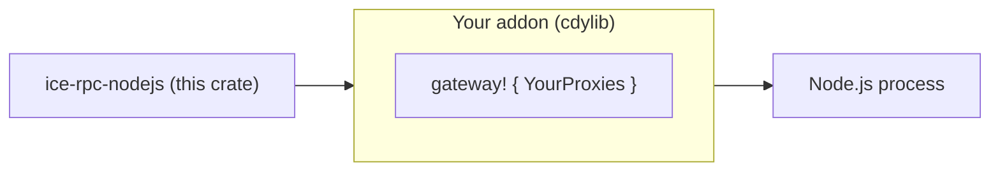

# ice-rpc-nodejs

The reusable **Node.js engine** for [`ice-rpc`](../ice-rpc/Readme.md): it lets a
Node.js process **provide** and **consume** ice-rpc services — the business logic
stays in JavaScript, the IPC transport stays in Rust over iceoryx2 shared memory.

This crate holds the bridge, the lifecycle, the dispatch and the error codes. It
knows **no service**: the list of services belongs to the addon, which supplies it
through the [`gateway!`](src/macros.rs:1) macro. The macro also emits the N-API
surface, so an addon is a handful of lines.



> The reference addon lives in [`gateway_nodejs`](../gateway_nodejs): it serves the
> example services of `common` and is what the tests and examples exercise.

## Requirements

- Rust **1.97** or newer (the workspace floor).
- Node.js **22.13** or newer (`@napi-rs/cli` needs it; the addon is built with
  `napi4`/`napi8`).

## Building an addon

An addon is a small `cdylib` crate that depends on this one and names its
services. Four files.

### `gateway-ma-societe/Cargo.toml`

```toml
[package]
name = "gateway-ma-societe"
version = "0.1.0"
edition = "2021"

[lib]
crate-type = ["cdylib"]

[dependencies]
ice-rpc-nodejs = "0.3"
# `napi` and `napi-derive` are needed directly: the `gateway!` macro emits
# `#[napi]` attributes and `::napi::…` paths, which resolve against the addon's
# own extern prelude.
napi = { version = "3", default-features = false, features = ["napi4", "napi8", "serde-json", "compat-mode", "dyn-symbols"] }
napi-derive = "3"
# The crate that declares your services with `#[service]`.
mes-services = { path = "../mes-services" }

[build-dependencies]
napi-build = "2"
```

### `gateway-ma-societe/build.rs`

```rust
fn main() {
    napi_build::setup();
}
```

### `gateway-ma-societe/src/lib.rs` — the whole addon

```rust
ice_rpc_nodejs::gateway! {
    mes_services::ConfigServiceProxy,
    mes_services::OrdersServiceProxy,
}
```

### `gateway-ma-societe/package.json`

```json
{
  "name": "gateway-ma-societe",
  "version": "0.1.0",
  "main": "index.js",
  "types": "index.d.ts",
  "napi": {
    "binaryName": "gateway-ma-societe",
    "targets": ["x86_64-unknown-linux-gnu"]
  },
  "scripts": {
    "build": "napi build --platform --release",
    "artifacts": "napi artifacts"
  },
  "devDependencies": { "@napi-rs/cli": "^3.8.6" }
}
```

```bash
npm install
npm run build        # produces gateway-ma-societe.<triple>.node + index.js + index.d.ts
```

## The service list

The list is a **compile-time** property of the addon, and it is the only thing an
addon maintains. Two consequences, both deliberate:

- listing a proxy the compiler cannot find is a **build error**;
- a service that is **not** listed is reported at runtime as `E_UNKNOWN_SERVICE`,
  and a method that is not declared as `E_UNKNOWN_METHOD`.

The same list drives both directions: `registerService` advertises it, and
`callService` dispatches to it, so the two cannot drift.

## Using it from Node.js

The surface is the same whatever the addon. A pure **consumer**:

```javascript
import * as gateway from 'gateway-ma-societe';

gateway.init(() => {});             // nothing to dispatch
const age = await gateway.callService('DatabaseService', 'get_user_age', 'Alice');
await gateway.shutdown();
```

A **provider** (the business logic is JavaScript):

```javascript
import * as gateway from 'gateway-ma-societe';

gateway.registerService('ContextService');   // only what THIS process provides
gateway.init((err, call) => {
  if (err) return;
  const { correlationId, method, args } = call;
  // `args` is a native JS value: no JSON.parse anywhere.
  gateway.resolveNodejsCall(
    correlationId,
    args === undefined
      ? { type: 'error', data: 'KeyNotFound' }
      : { type: 'next', data: args },
  );
});
```

**Prerequisites at runtime**: the provider runs in a **separate process**, on the
same machine, with a shared iceoryx2 root (the same `./config/iceoryx2.toml` on
both sides). A process cannot consume a service it provides itself.

The complete contract (argument convention, event envelope, error codes,
lifecycle) is in [`docs/nodejs-gateway-api-v2.md`](../docs/nodejs-gateway-api-v2.md).

### The N-API surface

| JavaScript | Returns |
|---|---|
| `registerService(name)` | `void` (throws `E_UNKNOWN_SERVICE`, `E_GATEWAY_STATE`) |
| `init(callback)` | `void` (`callback` is `(err, call)`) |
| `callService(service, method, args)` | `Promise<any>` — the first value |
| `callServiceStream(service, method, args)` | `Promise<any[]>` — every value |
| `emitNodejsEvent(correlationId, event)` | `void` — push an intermediate event |
| `resolveNodejsCall(correlationId, event)` | `void` — the terminal event |
| `shutdown()` | `Promise<void>` |
| `version()` | `string` |

## TypeScript binding

`napi` generates `index.d.ts`, which types the surface generically (`any`). A
**simple, typed** binding template — typed methods, a `ServiceMap` of your
services, and the argument-arity rules — is provided at
[`gateway_nodejs/types/gateway.d.ts`](../gateway_nodejs/types/gateway.d.ts). Copy
it into your project and replace the `ServiceMap` with your services.

## Publication

Two artifacts, two channels:

| Artifact | Published? | Where |
|---|---|---|
| `ice-rpc-nodejs` (this crate) | **yes** | **crates.io** — `cargo publish -p ice-rpc-nodejs` |
| Your addon (`gateway-ma-societe`) | your call | npm — see below |

This crate is published so a third party can build **their own** addon without
cloning the workspace. Your addon is yours: publish it under your own name if you
want a ready-to-install npm package.

### Publishing your addon to npm

Add the standard NAPI-RS release plumbing:

```json
{
  "scripts": {
    "prepublishOnly": "napi prepublish -t npm"
  },
  "publishConfig": { "access": "public" },
  "napi": {
    "binaryName": "gateway-ma-societe",
    "targets": [
      "x86_64-unknown-linux-gnu",
      "x86_64-unknown-linux-musl",
      "aarch64-unknown-linux-musl",
      "x86_64-apple-darwin",
      "aarch64-apple-darwin",
      "x86_64-pc-windows-msvc"
    ]
  }
}
```

Then, in CI: build each target with
`napi build --platform --release --target <triple>`, collect them with
`napi artifacts`, and run `napi prepublish -t npm` (it generates the per-platform
`optionalDependencies` packages and publishes them) before `npm publish`. A
GitHub-hosted matrix with an `NPM_TOKEN` secret is the usual setup. Without a
registry, `npm pack` → a `.tgz` distributed through GitHub Releases also works.

## Layout

```text
src/lib.rs        public API, module list, re-exports
src/macros.rs     the `gateway!` macro (table + N-API surface)
src/bridge.rs     the JS dispatcher, the pending table, the JSON host
src/services.rs   the GatewayService table + provider registration
src/consumer.rs   consumer dispatch over the table
src/napi_api.rs   the N-API implementations the macro wraps
src/state.rs      lifecycle: phase, bridge, shutdown guard
src/error.rs      GatewayError and the stable codes
```
