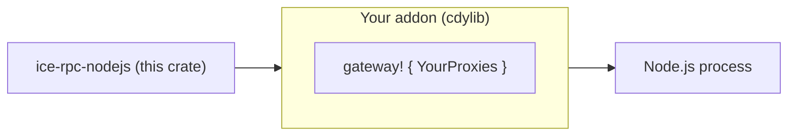

# ice-rpc-nodejs

The reusable **Node.js engine** for [`ice-rpc`](../ice-rpc/Readme.md): it lets a
Node.js process **provide** and **consume** ice-rpc services — the business logic
stays in JavaScript, the IPC transport stays in Rust over iceoryx2 shared memory.

This crate holds the bridge, the lifecycle, the dispatch and the error codes. It
knows **no service**: the list of services belongs to the addon, which supplies it
through the [`gateway!`](src/macros.rs:1) macro. The macro also emits the N-API
surface, so an addon is a handful of lines.



> The reference addon lives in [`gateway_nodejs`](../gateway_nodejs): it serves the
> example services of `common` and is what the tests and examples exercise.

## Requirements

- Rust **1.97** or newer (the workspace floor).
- Node.js **22.13** or newer (`@napi-rs/cli` needs it; the addon is built with
  `napi4`/`napi8`).

## Building an addon

An addon is a small `cdylib` crate that depends on this one and names its
services. Four files.

### `gateway-ma-societe/Cargo.toml`

```toml
[package]
name = "gateway-ma-societe"
version = "0.1.0"
edition = "2021"

[lib]
crate-type = ["cdylib"]

[dependencies]
ice-rpc-nodejs = "0.3"
# `napi` and `napi-derive` are needed directly: the `gateway!` macro emits
# `#[napi]` attributes and `::napi::…` paths, which resolve against the addon's
# own extern prelude.
napi = { version = "3", default-features = false, features = ["napi4", "napi8", "serde-json", "compat-mode", "dyn-symbols"] }
napi-derive = "3"
# The crate that declares your services with `#[service]`.
mes-services = { path = "../mes-services" }

[build-dependencies]
napi-build = "2"
```

### `gateway-ma-societe/build.rs`

```rust
fn main() {
    napi_build::setup();
}
```

### `gateway-ma-societe/src/lib.rs` — the whole addon

```rust
ice_rpc_nodejs::gateway! {
    mes_services::ConfigServiceProxy,
    mes_services::OrdersServiceProxy,
}
```

### `gateway-ma-societe/package.json`

```json
{
  "name": "gateway-ma-societe",
  "version": "0.1.0",
  "main": "index.js",
  "types": "index.d.ts",
  "napi": {
    "binaryName": "gateway-ma-societe",
    "targets": ["x86_64-unknown-linux-gnu"]
  },
  "scripts": {
    "build": "napi build --platform --release",
    "artifacts": "napi artifacts"
  },
  "devDependencies": { "@napi-rs/cli": "^3.8.6" }
}
```

```bash
npm install
npm run build        # produces gateway-ma-societe.<triple>.node + index.js + index.d.ts
```

## The service list

The list is a **compile-time** property of the addon, and it is the only thing an
addon maintains. Two consequences, both deliberate:

- listing a proxy the compiler cannot find is a **build error**;
- a service that is **not** listed is reported at runtime as `E_UNKNOWN_SERVICE`,
  and a method that is not declared as `E_UNKNOWN_METHOD`.

The same list drives both directions: `registerService` advertises it, and
`callService` dispatches to it, so the two cannot drift.

## Using it from Node.js

`napi build` writes three files next to the addon's `package.json`: `index.js`
(the loader), `index.d.ts` and `<binaryName>.<triple>.node`. JavaScript loads
**`index.js`** — the local file during development, the package name once the
addon is installed:

```javascript
// CommonJS — the generated loader is CommonJS.
const gateway = require('./index.js');            // in the addon directory
// const gateway = require('gateway-ma-societe'); // once published / installed
```

```javascript
// ESM (.mjs) — reach the same CommonJS module through createRequire.
import { createRequire } from 'node:module';
const require = createRequire(import.meta.url);
const gateway = require('./index.js');
```

> `gateway-ma-societe` is the **placeholder** name of the walkthrough above: it
> resolves only once *your* addon is published or installed under that name.
> During development the addon is loaded **by path** (`./index.js`). The generated
> loader is CommonJS, so prefer `require` (or a default `import gateway from …`)
> over a named ESM import like `import * as gateway from …`, whose named bindings
> are not guaranteed for a generated `module.exports`.

### A pure consumer — `consumer.js`

```javascript
'use strict';
// The addon generated by `npm run build` sits in the same directory.
const gateway = require('./index.js');

async function main() {
  // Nothing to dispatch in a pure consumer, but the bridge must exist.
  gateway.init(() => {});
  try {
    const age = await gateway.callService('DatabaseService', 'get_user_age', 'Alice');
    console.log(`Alice has ${age} years`);

    const values = await gateway.callServiceStream('NotificationService', 'watch', 3);
    console.log('stream:', values);
  } catch (error) {
    // The message starts with a stable code: E_NO_PROVIDER, E_BUSINESS, …
    console.error('call failed:', error.message);
  } finally {
    // Releases the IPC resources so the process can exit.
    await gateway.shutdown();
  }
}

main();
```

### A provider — `provider.js`

The business logic stays in JavaScript: the dispatcher is the only function the
addon needs. The snippet below is its shape; a complete, runnable version — with
its store, its lifecycle and its `Ctrl+C` handling — is the reference addon's
[`examples/provider-context.js`](../gateway_nodejs/examples/provider-context.js).

```javascript
'use strict';
const gateway = require('./index.js');

gateway.registerService('ContextService');   // only what THIS process provides
gateway.init((err, call) => {
  if (err) return;
  const { correlationId, method, args } = call;
  // `args` is a native JS value: N-API converted the intermediate Value tree,
  // and no JSON.parse is involved.
  gateway.resolveNodejsCall(
    correlationId,
    args === undefined ? { error: 'KeyNotFound' } : { data: args },
  );
});

// `init` does not block: keep the process alive, and shut ice-rpc down on Ctrl+C.
process.on('SIGINT', async () => {
  await gateway.shutdown();
  process.exit(0);
});
```

### The event envelope

A provider answers with an envelope, and the **entry point** decides what it
means:

| JavaScript | Wire | Meaning |
|---|---|---|
| `emitNodejsEvent(cid, { data: v })` | `Next(v)` | one intermediate value, call stays open |
| `resolveNodejsCall(cid, { data: v })` | **`CompleteWith(v)`** | closes with one last value, as a single sample |
| `resolveNodejsCall(cid, {})` | `Complete` | closes without a value |
| `resolveNodejsCall(cid, { error: e })` | `Error(e)` | closes with a business error |

Two rules make the surface hard to misuse:

- the closing event is **derived from the envelope** — `resolveNodejsCall` is
  never given a `type`;
- `emitNodejsEvent` refuses an `error`: a failure is terminal, so it belongs to
  `resolveNodejsCall`.

`resolveNodejsCall(cid, { data: v })` is the exact JavaScript equivalent of the
Rust `ice_rpc::of(v)`: a single `CompleteWith` sample rather than a `Next`
followed by a `Complete`. Pushing the value and then closing —

```javascript
gateway.emitNodejsEvent(correlationId, { data: v });
gateway.resolveNodejsCall(correlationId, {});
```

— is observably identical to a consumer, which reads `next` then `complete`, but
it puts **two** samples on the bus instead of one.

The presence of the **key** decides, not its value: `{ data: null }` closes with a
`null` value — the `CompleteWith(())` of a unit method — while `{}` closes without
one. `data` must fit the declared success type. A **top-level** `Vec<u8>` is a
base64 string, like every argument; a `Vec<u8>` **field** inside a struct follows
`serde` and is an array of numbers.

The `{ type, data }` envelope of the earlier contract is **removed**: passing it
to either entry point fails with `E_INVALID_ARGS`, which turns a silent "lone
`Next` that never terminates the stream" into a diagnosable error.

### Cost of the JSON bridge

The bridge does **no JSON text**: N-API converts a `serde_json::Value` tree to
native JS objects, so there is no `JSON.stringify` / `JSON.parse`. The tree is
still an allocation, and it is the intermediate cost of both directions:

```text
provider: IPC (rkyv) → decode → serde_json::Value → N-API → JS
consumer: JS → N-API → serde_json::Value → rkyv → IPC
```

The envelope normalization also clones `data` once per event. The
[`json_value_cost`](../ice-rpc/benches/json_value_cost.rs:1) bench prices the
tree against the rkyv decode/encode on the shapes the services carry. On the
machine used for the decision:

| Shape | `to_value` | `from_value` | `Value::clone` | rkyv encode/decode |
|---|---:|---:|---:|---:|
| `u32` | 4.34 ns | 23.45 ns | 9.59 ns | 26.04 / 1.05 ns |
| `PersonneInfo` | 204.4 ns | 94.6 ns | 133.9 ns | 96.8 / 64.5 ns |
| `Vec<ContextEntry>` × 1024 | 204.8 µs | 73.28 µs | 171.7 µs | 10.61 / 65.19 µs |
| `HttpResponseParams`, 1 MiB body | 25.99 ms | 9.846 ms | 20.78 ms | 22.76 / 23.12 µs |

The tree is in the noise for scalar and short-text payloads, and dominates for
long lists and for a `Vec<u8>` **field** (which `serde_json` represents as an
array of numbers; only a top-level `Vec<u8>` argument is base64-encoded). A
`#[napi(object)]` fast path was considered and rejected: it cannot cover enums
with data or custom `serde` attributes, it would make the shared service crates
depend on napi, and it would not remove the V8 object creation. The full
reasoning, the measurement protocol and the conditions to revisit the decision
are in [`nodejs-json-bridge-adr.md`](../docs/nodejs-json-bridge-adr.md).

### Running it

A provider and its consumer are **two processes**, so two terminals. Run every
command from the addon directory (the one holding `package.json`):

```bash
# once: build the addon (index.js, index.d.ts, <binary>.<triple>.node)
npm install
npm run build          # release; `npm run build:debug` for the tests' build

# terminal 1 — the JavaScript provider (blocks; Ctrl+C stops it)
node provider.js

# terminal 2 — the consumer, calling the provider above
node consumer.js
```

To call a **Rust** service instead, start a Rust provider in terminal 1 and keep
`consumer.js` in terminal 2:

```bash
# terminal 1, from the workspace root: hosts DatabaseService, ConfigService, …
cargo run -p ice-rpc --example provider-app --features tokio
```

Both terminals must run from the same directory — or resolve the same
`./config/iceoryx2.toml` — since that configuration *is* the iceoryx2 domain two
processes share.

`provider.js` and `consumer.js` are the two files above, dropped in the addon
directory. In this repository the reference addon is
[`gateway_nodejs`](../gateway_nodejs) and it ships the same pair ready to run, so
the whole round trip needs no code of your own:

```bash
cargo make build-gateway-debug        # builds the reference addon (npm run build:debug)
cargo make provider                   # a Rust provider to call (DatabaseService, …)
cargo make provider-context-nodejs    # the Node.js provider + consumer example
cargo make gateway-e2e                # two-process Node ↔ Node round trip
```

**Prerequisites at runtime**: the provider runs in a **separate process**, on the
same machine, with a shared iceoryx2 root (the same `./config/iceoryx2.toml` on
both sides). A process cannot consume a service it provides itself.

The complete contract (argument convention, event envelope, error codes,
lifecycle) is in [`docs/nodejs-gateway-api-v3.md`](../docs/nodejs-gateway-api-v3.md).

### The N-API surface

| JavaScript | Returns |
|---|---|
| `registerService(name)` | `void` (throws `E_UNKNOWN_SERVICE`, `E_GATEWAY_STATE`) |
| `init(callback)` | `void` (`callback` is `(err, call)`) |
| `callService(service, method, args)` | `Promise<any>` — the first value |
| `callServiceStream(service, method, args)` | `Promise<any[]>` — every value |
| `emitNodejsEvent(correlationId, { data })` | `void` — push an intermediate value |
| `resolveNodejsCall(correlationId, { data } \| { error } \| {})` | `void` — build the terminal event and close |
| `shutdown()` | `Promise<void>` |
| `version()` | `string` |

## TypeScript binding

`napi` generates `index.d.ts`, which types the surface generically (`any`). A
**simple, typed** binding template — typed methods, a `ServiceMap` of your
services, and the argument-arity rules — is provided at
[`gateway_nodejs/types/gateway.d.ts`](../gateway_nodejs/types/gateway.d.ts). Copy
it into your project and replace the `ServiceMap` with your services.

## Publication

Two artifacts, two channels:

| Artifact | Published? | Where |
|---|---|---|
| `ice-rpc-nodejs` (this crate) | **yes** | **crates.io** — `cargo publish -p ice-rpc-nodejs` |
| Your addon (`gateway-ma-societe`) | your call | npm — see below |

This crate is published so a third party can build **their own** addon without
cloning the workspace. Your addon is yours: publish it under your own name if you
want a ready-to-install npm package.

### Publishing your addon to npm

Add the standard NAPI-RS release plumbing:

```json
{
  "scripts": {
    "prepublishOnly": "napi prepublish -t npm"
  },
  "publishConfig": { "access": "public" },
  "napi": {
    "binaryName": "gateway-ma-societe",
    "targets": [
      "x86_64-unknown-linux-gnu",
      "x86_64-unknown-linux-musl",
      "aarch64-unknown-linux-musl",
      "x86_64-apple-darwin",
      "aarch64-apple-darwin",
      "x86_64-pc-windows-msvc"
    ]
  }
}
```

Then, in CI: build each target with
`napi build --platform --release --target <triple>`, collect them with
`napi artifacts`, and run `napi prepublish -t npm` (it generates the per-platform
`optionalDependencies` packages and publishes them) before `npm publish`. A
GitHub-hosted matrix with an `NPM_TOKEN` secret is the usual setup. Without a
registry, `npm pack` → a `.tgz` distributed through GitHub Releases also works.

## Layout

```text
src/lib.rs        public API, module list, re-exports
src/macros.rs     the `gateway!` macro (table + N-API surface)
src/bridge.rs     the JS dispatcher, the pending table, the JSON host
src/services.rs   the GatewayService table + provider registration
src/consumer.rs   consumer dispatch over the table
src/napi_api.rs   the N-API implementations the macro wraps
src/state.rs      lifecycle: phase, bridge, shutdown guard
src/error.rs      GatewayError and the stable codes
```
